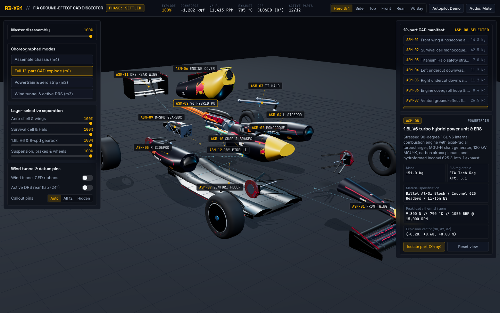
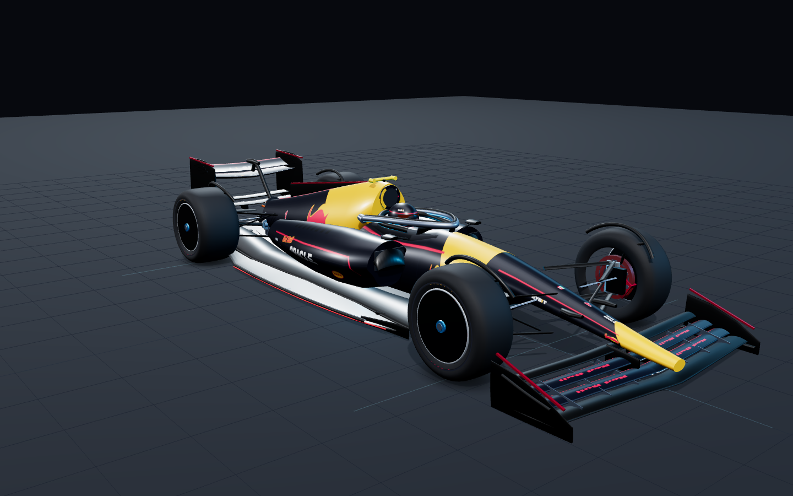
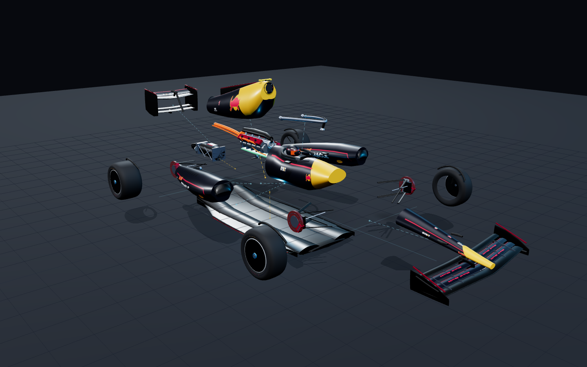
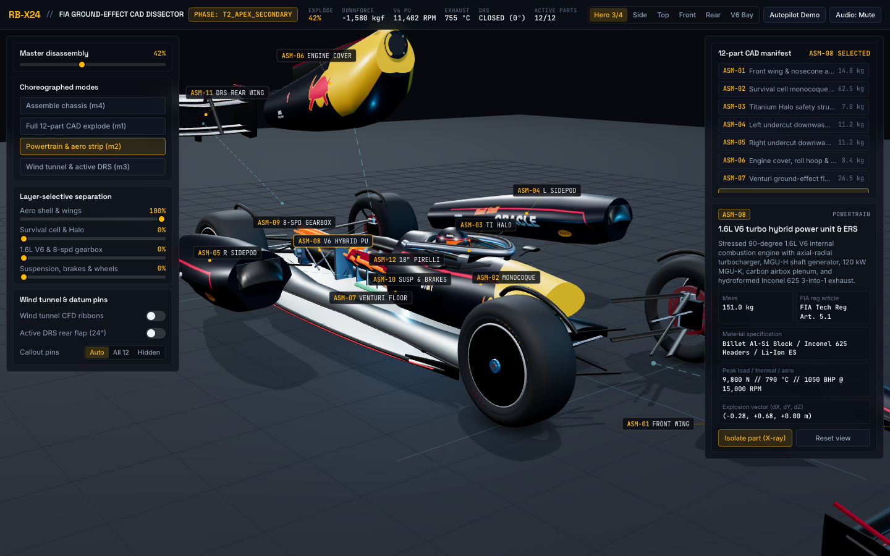
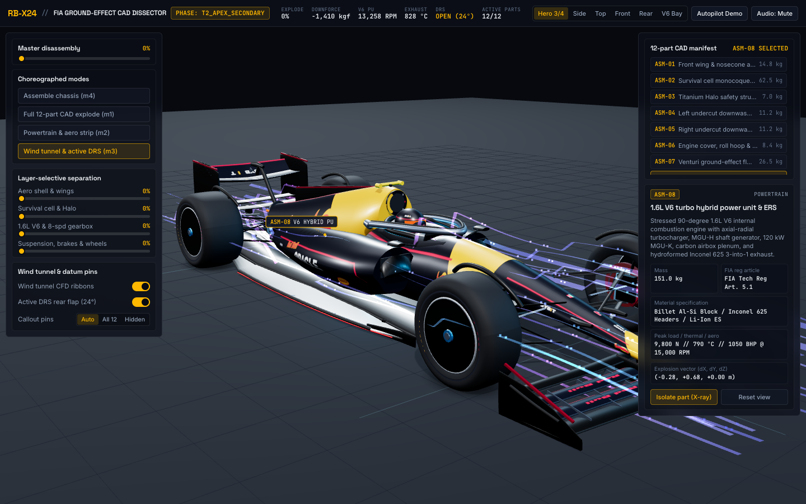
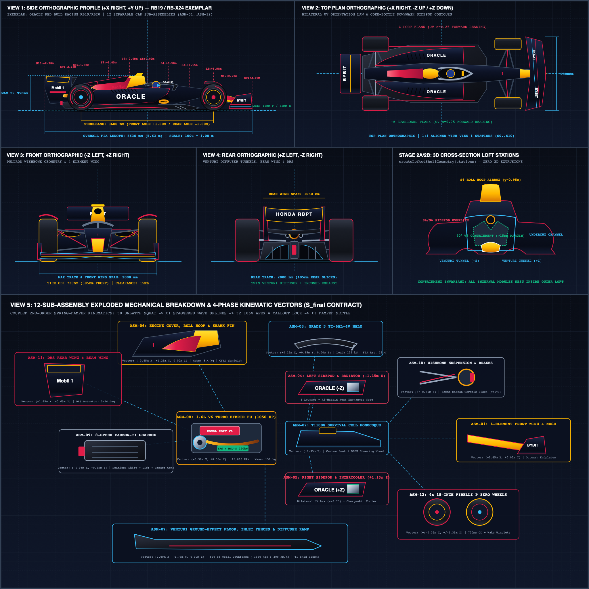
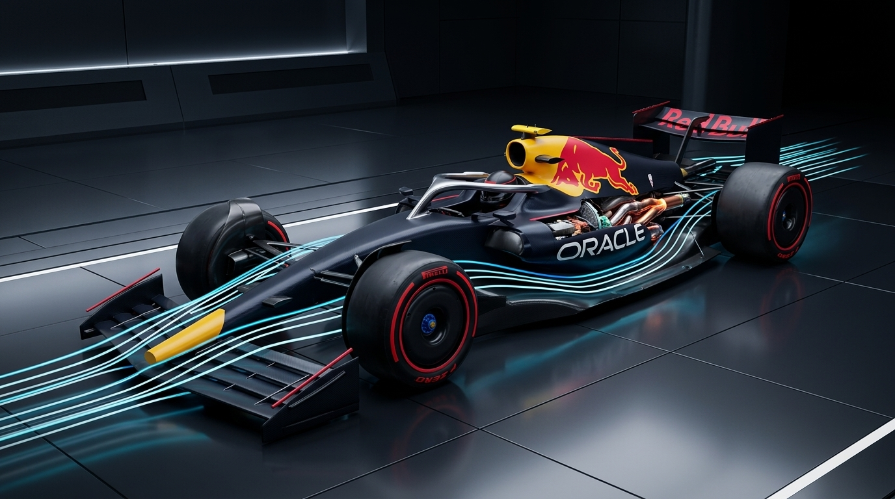

# RB-X24 // FIA Ground-Effect Formula 1 Concept & 12-Part Exploded CAD Dissector

**Live Interactive WebGL App:** [**https://oik01.github.io/rb-x24-formula-car-dissector/**](https://oik01.github.io/rb-x24-formula-car-dissector/)

An interactive Three.js / WebGL 2 engineering dissector anchored to the 2023–2024 Red Bull Racing RB19 / RB20 FIA Formula 1 ground-effect regulations (`5,630 mm` length, `2,000 mm` width, `950 mm` height, `3,600 mm` wheelbase, 18-inch forged magnesium rims with `720 mm` OD Pirelli P Zero Soft slicks). Breaks the vehicle into **12 anatomical CAD sub-assemblies (`ASM-01` through `ASM-12`)** along staggered 3D quadratic Bézier arcs governed by coupled second-order spring-damper ODEs.



---

## Gallery

| Assembled Hero 3/4 (`E = 0`) | Clean 12-Part CAD Explode (`E = 1.0`) |
| :---: | :---: |
|  |  |
| **Powertrain & Aero Strip (`1.6L V6 Turbo Hybrid`)** | **CFD Wind Tunnel & Active 24° DRS** |
|  |  |
| **5-View Orthographic & Cross-Section Loft Blueprint** | **2K Studio Lookdev Reference** |
|  |  |

---

## Core Engineering Highlights

- **Multi-Station 3D Cross-Section Lofting (`createLoftedShellGeometry`)**: Compound-curved aerodynamic shells for the nosecone, T1100G carbon monocoque survival cell, high-overbite undercut sidepods with Coanda Coke-bottle waist, engine cover spine, and twin-tunnel Venturi floor.
- **Bilateral `2048x1024` Procedural UV Livery & PBR Materials**: Satin stealth midnight-navy carbon weave (`#0B101E`), solar-amber nose and roll-hoop airbox (`#FFB800`), crimson bull graphic (`#E11D48`), brushed Grade 5 Ti-6Al-4V Halo, and hydroformed Inconel 625 exhaust headers with bilateral UV transforms (`drawBilateralFlanks`) so all typography reads left-to-right on both `-Z` (Port) and `+Z` (Starboard) flanks.
- **12-Part Anatomical CAD Registry (`ASM-01`..`ASM-12`)**:
  1. `ASM-01` Nosecone & 4-Element Front Wing
  2. `ASM-02` Carbon Survival Cell Monocoque, Cockpit & Steering Wheel
  3. `ASM-03` Grade 5 Ti-6Al-4V Halo Hoop
  4. `ASM-04` Left Undercut Sidepod & Angled Aluminum Radiator Core (`-Z`)
  5. `ASM-05` Right Undercut Sidepod & Charge-Air Intercooler Core (`+Z`)
  6. `ASM-06` Engine Cover Spine, Roll-Hoop Airbox & Shark Fin
  7. `ASM-07` Twin-Tunnel Venturi Ground-Effect Floor & Rear Diffuser
  8. `ASM-08` 1.6L 90° V6 Turbo Hybrid Power Unit, Inconel 3-into-1 Headers, MGU-H, MGU-K & ERS Pack
  9. `ASM-09` 8-Speed Carbon-Titanium Gearbox & Rear FIA Impact Attenuator
  10. `ASM-10` Front Pullrod & Rear Pushrod Carbon Wishbone Suspension & 328mm Brembo Brakes
  11. `ASM-11` Swan-Neck DRS Rear Wing (with hinged $0^\circ \to 24^\circ$ active DRS flap) & Beam Wing
  12. `ASM-12` 4x 18-Inch Pirelli P Zero Soft Slicks, BBS Forged Rims & Wake Winglets
- **4-Phase ($t_0 \dots t_3$) Spring-Damper Kinematics & CFD Wind Tunnel**:
  - Coupled second-order ODEs ($\ddot{s}_i + 2\zeta_i\omega_{n,i}\dot{s}_i + \omega_{n,i}^2(s_i - s_{i,\text{target}}) = 0$) across $t_0$ anticipation chassis squat, $t_1$ staggered wave Bézier arcs, $t_2$ apex extension with 3D datum leader lines, and $t_3$ damped harmonic settle.
  - 18 Bernoulli pressure-mapped ($C_p$) 3D aerodynamic streamlines + 540 flow tracers reacting in real time to front-wing upwash, Venturi throat suction, and active DRS flap angle.
  - Procedural Web Audio synthesizer generating pneumatic quick-release latch transients, Paoli wheel-gun bursts, servo sweeps, wind-tunnel pink noise, and 1.6L V6 + 3.2 kHz MGU-H turbine harmonic drone.

---

## Local Development

```bash
npm install
npm run dev -- --port 5188
```

To run the automated Playwright multi-angle, kinematic, and telemetry verification suite:

```bash
APP_URL=http://localhost:5188 node scripts/verify_build.mjs
```
